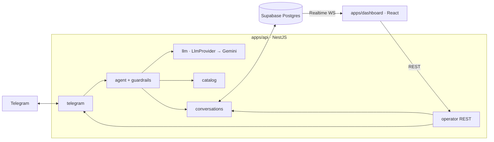

# CodeAndes Academy — Agente de ventas en Telegram + Panel de mando

Proyecto para la **Hackathon UTA 2026 · Ecosistema Multi-Agente para Ventas** (FISEI). Modelo híbrido IA–humano para un centro de capacitación tecnológica ficticio, **CodeAndes Academy** (Ambato):

- **Módulo A — Agente en Telegram:** asesora "Andrea" con tono humano: perfila al prospecto, resuelve dudas del pénsum con el catálogo oficial, maneja objeciones y guía la inscripción. Entiende notas de voz.
- **Módulo B — Panel de mando:** dashboard web en tiempo real con todos los chats concurrentes, termómetro del lead (interesado, dudoso, frustrado, lead caliente), toma de control, envío como bot y "Devolver a la IA".

Documentación: [arquitectura](docs/ARCHITECTURE.md) · [plan](docs/PLAN.md) · [catálogo](docs/CATALOGO.md) · [batería de pruebas](docs/PRUEBAS.md) · [guion de demo](docs/DEMO.md) · [reto](docs/RETO.md)

## Arquitectura en 30 segundos



- **Capas separadas:** el conector (`telegram`) es el único que conoce grammY; el pipeline (`agent`) no sabe de Telegram ni de HTTP; el proveedor LLM está detrás de una interfaz (`LLM_PROVIDER`), y la persistencia y el handover viven en `conversations`.
- **Una llamada estructurada por mensaje:** Gemini devuelve un JSON validado con zod (`reply`, `lead_state`, `intent`, `profile_updates`, `handover_requested`, `injection_detected`, …).
- **Contexto eficiente:** prompt fijo y catálogo compacto (prefijo estable, cacheable), perfil del lead estructurado, resumen acumulado y solo los últimos 12 mensajes. Se registran los tokens y la latencia de cada llamada.
- **Guardrails en capas:** reglas inmutables y entrada delimitada, detector heurístico previo y validación de la salida contra el catálogo (importes, porcentajes, "gratis", fuga del prompt). Si la respuesta no pasa, se regenera o se usa una respuesta segura.
- **Handover:** `ai_paused` por conversación. Se activa por frustración, por petición de un humano o cuando el operador interviene. Mientras está activo no se infiere, y la IA retoma con lo que dijo el asesor.

## Estructura

```
apps/
  api/          NestJS: telegram, agent, guardrails, llm, conversations, operator, catalog, supabase
  dashboard/    React + Vite + Tailwind + shadcn/ui (Supabase Realtime)
supabase/
  migrations/001_init.sql   esquema, RLS de solo lectura y publicación Realtime
  seed.sql                  catálogo oficial (7 cursos, 2 promociones)
docs/           arquitectura, plan, catálogo, pruebas y demo
render.yaml     blueprint del despliegue de la API
```

## Puesta en marcha local

Requisitos: Node ≥ 20 y pnpm (`corepack enable`).

1. **Supabase:** crea un proyecto y, en el *SQL Editor*, ejecuta `supabase/migrations/001_init.sql` y luego `supabase/seed.sql`.
2. **Bot:** crea uno con @BotFather (`/newbot`) y guarda el token.
3. **Gemini:** crea una API key en https://aistudio.google.com/apikey.
4. **Variables:** copia `apps/api/.env.example` → `apps/api/.env` y `apps/dashboard/.env.example` → `apps/dashboard/.env` y complétalas (tablas abajo).
5. Instala y arranca:
   ```bash
   pnpm install
   pnpm dev
   ```
   La API queda en `http://localhost:3000` con long polling de Telegram y el panel en `http://localhost:5173`.

### Variables de la API (`apps/api/.env`)

| Variable | Descripción |
|---|---|
| `TELEGRAM_BOT_TOKEN` | Token de @BotFather |
| `TELEGRAM_MODE` | `polling` (local) o `webhook` (producción) |
| `TELEGRAM_WEBHOOK_SECRET` | Secreto del webhook, solo `[A-Za-z0-9_-]` (`openssl rand -hex 24`) |
| `PUBLIC_API_URL` | URL HTTPS pública de la API (modo webhook) |
| `LLM_PROVIDER` / `GEMINI_API_KEY` / `GEMINI_MODEL` | Proveedor LLM (`gemini`, `gemini-2.5-flash`) |
| `SUPABASE_URL` / `SUPABASE_SERVICE_ROLE_KEY` | Proyecto Supabase; clave secreta (`sb_secret_…` o service role), solo en el servidor |
| `DASHBOARD_ORIGIN` | Orígenes permitidos por CORS, separados por comas |
| `CONTEXT_WINDOW_MESSAGES` / `SUMMARY_EVERY_N_MESSAGES` | Ventana de contexto (12) y frecuencia del resumen (8) |

### Variables del dashboard (`apps/dashboard/.env`)

| Variable | Descripción |
|---|---|
| `VITE_SUPABASE_URL` | URL del proyecto Supabase |
| `VITE_SUPABASE_ANON_KEY` | Clave pública (`sb_publishable_…` o anon). El RLS solo permite lectura |
| `VITE_API_URL` | URL de la API |

## Despliegue

### API → Render

1. *New → Blueprint* y elige este repo (usa `render.yaml`), o crea un *Web Service* con:
   - Build: `corepack enable && pnpm install --frozen-lockfile && pnpm --filter api build`
   - Start: `pnpm --filter api start:prod` · Health check: `/health`
2. Variables: las de la tabla con `TELEGRAM_MODE=webhook`, `PUBLIC_API_URL=https://<servicio>.onrender.com` y `DASHBOARD_ORIGIN=https://<dashboard>.vercel.app`.
3. Al arrancar, la API registra el webhook (`setWebhook` con `secret_token`) automáticamente.

> El plan gratuito de Render se duerme tras 15 min sin tráfico. Un ping externo a `/health` (p. ej. UptimeRobot cada 5 min) lo mantiene despierto para la demo.

### Dashboard → Vercel

1. *Add New Project* → este repo → **Root Directory:** `apps/dashboard` (framework Vite).
2. Variables `VITE_SUPABASE_URL`, `VITE_SUPABASE_ANON_KEY` y `VITE_API_URL=https://<servicio>.onrender.com`.
3. Añade la URL de Vercel a `DASHBOARD_ORIGIN` en Render (CORS).

## Seguridad y limitaciones conocidas

- La clave secreta de Supabase solo vive en la API. El dashboard usa la clave pública con RLS de solo lectura y escribe a través de la API.
- Demo: el panel no tiene login de operador. El siguiente paso sería Supabase Auth con políticas `to authenticated` y una API key de operador.
- Precios y promociones salen solo de la base de datos. El LLM no puede crearlos y la salida se valida contra el catálogo.
