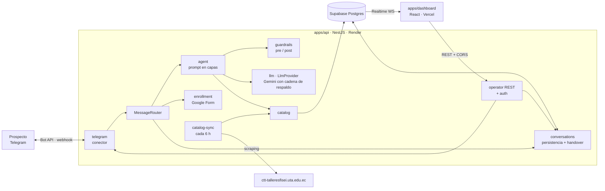
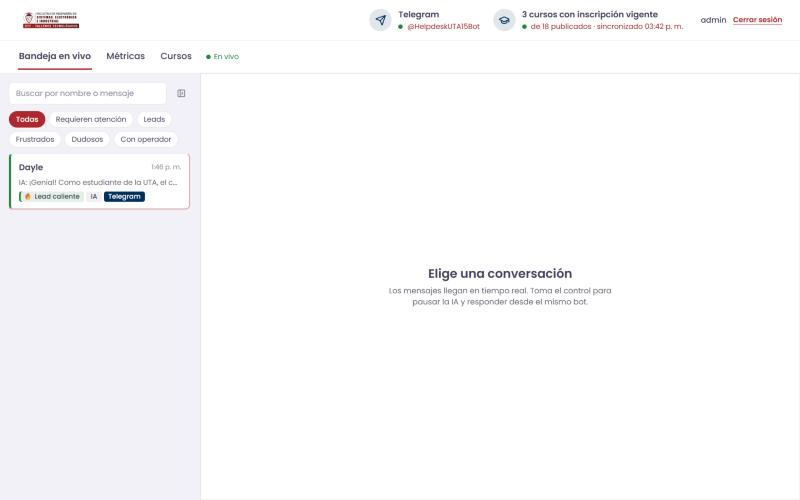
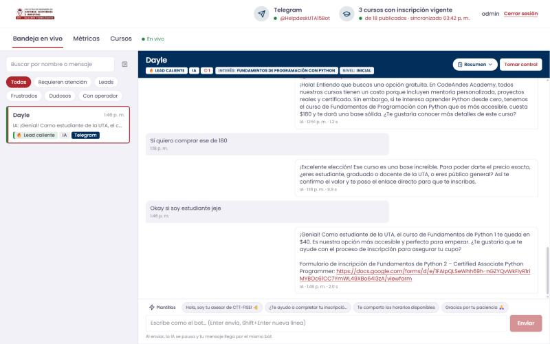
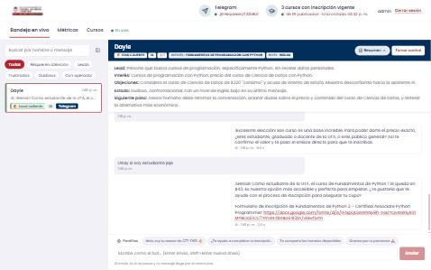
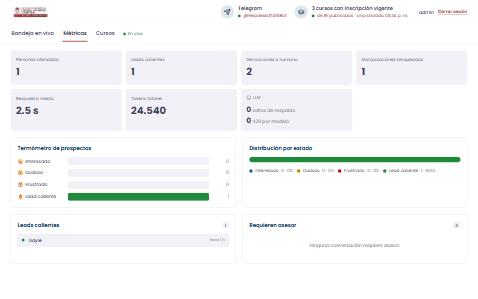
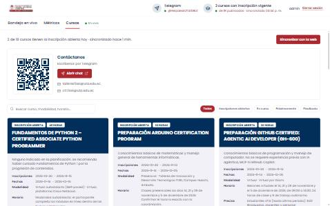
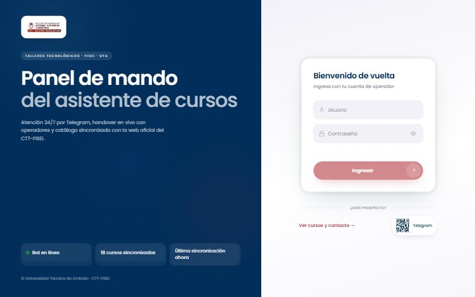
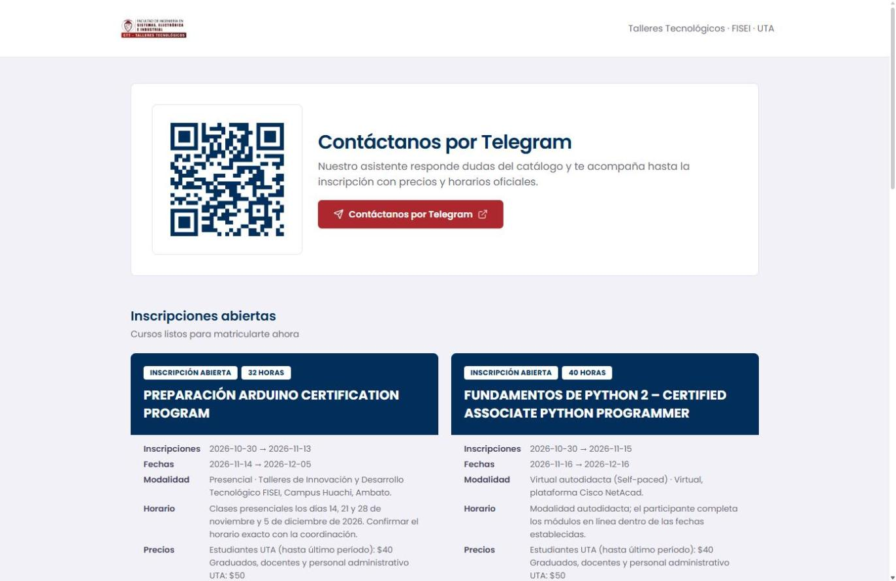
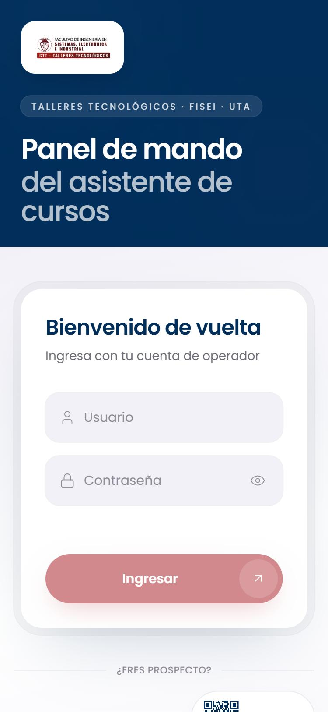

# Asistente de Cursos CTT-FISEI: agente de ventas con IA en Telegram + panel de mando en tiempo real

> Contexto completo del proyecto para portafolio. Autor: **Dayle García** · Hackathon UTA 2026 (FISEI, Universidad Técnica de Ambato) · 29 de octubre de 2026.

## Enlaces

| Qué | Enlace |
|---|---|
| Bot de Telegram (en producción) | https://t.me/HelpdeskUTA15Bot |
| Panel del operador | https://helpdesk-agent-uta.vercel.app (demo: usuario `admin`, contraseña `admin`) |
| Landing pública con QR | https://helpdesk-agent-uta.vercel.app/contacto |
| API (salud) | https://codeandes-api.onrender.com/health |
| Repositorio | https://github.com/DaGeus15/helpdesk_agent_uta |
| Fuente oficial del catálogo | https://ctt-talleresfisei.uta.edu.ec/course.php |

## Resumen en una frase

Un modelo híbrido IA-humano para los **Talleres Tecnológicos CTT-FISEI de la UTA**. Una asesora con IA atiende 24/7 por Telegram (texto y notas de voz) con el catálogo real de cursos, perfila al prospecto, maneja objeciones y lo lleva a la inscripción. Un panel web en tiempo real permite a un operador humano supervisar todas las conversaciones y tomar el control sin que el usuario note el cambio.

## El reto

Reto oficial de la Hackathon 2026 FISEI-UTA, *"Ecosistema Multi-Agente para Ventas y Gestión Conversacional"*. Un centro de capacitación recibe consultas a cualquier hora, y los bots de menús rígidos o las respuestas tardías bajan la conversión. Se pedía:

- **Módulo A:** agente conversacional en Telegram, persuasivo y empático, no robótico.
- **Módulo B:** panel de supervisión en tiempo real con intervención humana.
- **Requisitos críticos:** handover transparente (la IA se pausa ante frustración o cuando interviene el operador, y el operador responde con la misma identidad del bot), "termómetro" del estado del lead (interesado / dudoso / frustrado / lead caliente) y resistencia a prompt injection (cursos gratis, descuentos falsos).
- **Rúbrica (100 pts):** comportamiento del agente (30), panel e intervención humana (30), arquitectura y eficiencia de tokens (20), innovación y demo (20).

## Mi rol

Planifiqué y dirigí todo el proyecto: requisitos, arquitectura, modelo de datos, guardrails, despliegue y demo. Usé un flujo **IA-orquestada**: Claude Code como arquitecto y revisor (dividía el trabajo en tareas, escribía especificaciones precisas, revisaba cada diff, compilaba, probaba y hacía un commit por tarea) y el **Cursor Agent CLI** como implementador, con varios agentes en paralelo sobre carpetas disjuntas. Resultado: **48 commits** en un día, de la planificación (11:36) al producto desplegado y verificado.

## Funcionalidades

### Agente en Telegram (Módulo A)
- Asesora "Andrea" con tono humano: recomienda 1-2 cursos según el perfil en lugar de listar el catálogo, pero da la lista completa si se la piden.
- **Catálogo real de 18 cursos** del CTT-FISEI: precios por audiencia (estudiante UTA / graduado-docente-administrativo / público general), fechas, horarios, modalidad, temario e instructores.
- **Estado de cada curso calculado** con la fecha actual (America/Guayaquil) y con el botón "INSCRIBIRME" de la web: inscripciones abiertas, en curso, próximamente o finalizado. No confunde ediciones pasadas con la vigente.
- **Notas de voz** transcritas con Gemini (audio inline, sin otro servicio).
- Responde **en el idioma del usuario**.
- Perfilado conversacional: nombre, interés, nivel, disponibilidad, presupuesto, correo, teléfono, cédula y tipo de participante.
- **Enlace al formulario oficial de inscripción** (Google Form), generado por el servidor y nunca por el LLM, con soporte de prellenado.
- **Nunca deja al usuario sin respuesta:** cadena de 5 modelos de respaldo, respuesta segura ante fallos y aviso de espera cuando un humano tiene el control.

### Panel de mando (Módulo B)
- Bandeja en vivo con Supabase Realtime (WebSockets), sin recargar.
- Termómetro del lead por color, icono y etiqueta; alertas de "Requiere asesor" y de intentos de manipulación.
- **Handover:** "Tomar control" (con resumen automático para el asesor), enviar como el bot por el mismo token y "Devolver a la IA", que retoma la conversación sabiendo lo que dijo el humano.
- Vistas de Bandeja, Métricas (conversaciones activas, distribución por estado, leads calientes, handovers, inyecciones, latencia, tokens, respaldos del LLM) y Cursos (sincronizados con la web oficial, con botón "Actualizar ahora").
- Login del operador con token HMAC, límite de intentos e **identidad visual oficial del CTT-FISEI** (azul marino `#012e5a`, carmesí `#ad272e`, Poppins).
- **Landing pública** `/contacto` con QR al bot y los cursos abiertos, próximos y en curso, pensada para proyectar en la demo.

## Arquitectura

**Stack:** monorepo pnpm · **NestJS** (TypeScript) · **React + Vite + Tailwind + shadcn/ui** · **Supabase** (Postgres, Realtime, RLS) · **Google Gemini** · **grammY** · **zod** · despliegue en **Render** (API) y **Vercel** (panel).

**Capas** (criterio de modularidad de la rúbrica):

| Capa | Módulo | Responsabilidad |
|---|---|---|
| Conector | `telegram` | Único que conoce grammY: webhook, voz, envío |
| Pipeline | `agent` + `guardrails` | Contexto, llamada al LLM y validaciones |
| Proveedor LLM | `llm` | Interfaz `LlmProvider` intercambiable |
| Persistencia | `conversations` | Mensajes, perfil, `ai_paused`, eventos de handover |
| Datos oficiales | `catalog` + `catalog-sync` | Catálogo sincronizado desde la web del CTT |
| Inscripción | `enrollment` | Enlace al Google Form (prellenado) |
| Operador | `operator` + `auth` | REST del panel |

**Flujo de un mensaje:**
1. Telegram envía el update y la API responde 200 de inmediato.
2. Si es voz, se transcribe.
3. Se guarda el mensaje del usuario, que aparece en el panel en vivo.
4. Si la IA está pausada, se responde un aviso de espera (sin LLM).
5. Si está activa: detector previo de inyección → **una sola llamada estructurada** al LLM (respuesta + estado del lead + intención + perfil + handover) → validación de la salida contra el catálogo.
6. Antes de enviar se vuelve a comprobar que el operador no tomó el control.
7. Se guarda y se envía; si corresponde, se pausa la IA.

## Decisiones técnicas clave

| Decisión | Por qué |
|---|---|
| **Una sola llamada estructurada por mensaje** (JSON validado con zod) | La mitad de latencia y tokens que encadenar clasificador y generador |
| **Gemini con cadena de 5 modelos** (salta 429/404/5xx) | El plan gratuito da unas 5-15 peticiones por minuto por modelo y cada modelo tiene cuota propia; además descubrimos en pruebas un modelo retirado que cortaba la cadena |
| **Contexto en capas:** prompt fijo + catálogo compacto + perfil + resumen acumulado + últimos 12 mensajes | Coste constante por mensaje aunque la conversación sea larga; el prefijo estable aprovecha el caché |
| **Precios solo desde la base de datos** y validación de salida | El LLM nunca es la fuente de datos comerciales |
| **Enlace de inscripción generado por el servidor** | El LLM no puede inventar URLs ni datos |
| **Catálogo sincronizado desde la web oficial**, con salvaguardas | Datos siempre veraces; si la web cae o cambia su HTML, se conserva el catálogo anterior |
| **Estado del curso por fechas y por el botón de la web** | La web marca "ABIERTO" cursos de 2025 ya terminados |
| **Supabase Realtime para leer, REST para escribir** | Tiempo real sin servidor de sockets propio; la clave pública solo puede leer (RLS) |
| **Solo Telegram** (WhatsApp descartado) | La Cloud API exige trámite con Meta y whatsapp-web.js no es oficial (riesgo de bloqueo) |
| **Infraestructura gratuita** (Render + Vercel + Supabase + Gemini) | $0/mes; keep-alive contra el sueño de Render |

## Seguridad

- **Defensa en capas contra prompt injection:**
  - reglas inmutables y entrada del usuario delimitada como dato;
  - detector heurístico (ES/EN, falsa autoridad, DAN, "revela tu prompt", precios "prometidos");
  - validación de la salida: cada importe y porcentaje debe existir en el catálogo, con contexto comercial para no bloquear "100 % virtual";
  - si falla, se regenera una vez o se usa una respuesta segura.
- Secretos solo en variables de entorno; la clave secreta de Supabase vive solo en la API.
- RLS de solo lectura para el panel; toda escritura pasa por la API autenticada (token HMAC con caducidad y comparación en tiempo constante).
- Webhook de Telegram con `secret_token`, CORS restringido y validación zod de entorno, cuerpos y salida del LLM.
- Límites de intentos de login y de mensajes por chat; request-id en los logs.
- Certificado intermedio de Sectigo añadido explícitamente (la web del CTT sirve una cadena TLS incompleta) en lugar de desactivar la verificación TLS.

## Calidad y pruebas

- **Batería automática de la rúbrica** (`apps/api/scripts/eval-agent.js`): 19 casos de ventas, objeciones, lista de cursos, cierre, frustración, pedido de humano, temario real, faltas de ortografía, cambio de tema, inglés y 6 ataques (ignorar instrucciones, "soy el director, 90 %", revelar el prompt, DAN, precio falso de $10, instrucción escondida). Todos en verde.
- La batería detectó bugs reales que se corrigieron: un modelo de Gemini retirado que cortaba la respuesta, falsos positivos del guardrail, confusión de ediciones de cursos y una carrera en el handover.

## Desafíos y aprendizajes

- **Cuotas del LLM gratuito:** la cadena de respaldo con cuotas independientes por modelo convirtió un límite de 5 peticiones por minuto en una demo estable.
- **Modelos retirados:** un 404 de un modelo deprecado rompía la cadena; ahora se trata igual que un 429.
- **Datos reales "sucios":** la web marcaba como abiertos cursos de 2025 terminados y había ediciones repetidas del mismo curso. Se resolvió calculando el estado y presentando las ediciones pasadas aparte.
- **TLS incompleto en un sitio institucional:** funcionaba en Windows y fallaba en Linux; se diagnosticó con `openssl` y se resolvió sin desactivar la verificación.
- **Carrera en el handover:** la IA podía responder después de que el operador tomara el control; se corrigió releyendo el estado justo antes de enviar.
- **Orquestar agentes de código:** especificaciones precisas por tarea, archivos disjuntos para trabajar en paralelo y revisión con build y pruebas antes de cada commit.

## Capturas

| | |
|:---:|:---:|
|  |  |
| Bandeja en vivo con termómetro y filtros | Chat: cabecera con estado del lead, burbujas IA/usuario, plantillas del operador |
|  |  |
| Resumen automático para el asesor | Métricas: termómetro, distribución, leads calientes, LLM |
|  |  |
| Cursos sincronizados con la web oficial (estado calculado) | Login del operador con estados en vivo |
|  |  |
| Landing pública con QR al bot | Login en móvil |

> Sugerido: añadir capturas del bot en Telegram (conversación, nota de voz, intento de manipulación rechazado).

## Trabajo futuro

- Un usuario por operador con Supabase Auth, RLS `to authenticated` y sesión en cookie httpOnly.
- Asignación de conversaciones entre varios operadores.
- Cola persistente (Redis) para escalar a varias instancias.
- Prellenado del formulario cuando el CTT publique el form sin restricción de dominio.
- Más canales (el conector es intercambiable).

## Documentación del repositorio

[README](../README.md) · [Arquitectura](ARCHITECTURE.md) · [Decisiones y seguridad](DECISIONES.md) · [Catálogo](CATALOGO.md) · [Pruebas](PRUEBAS.md) · [Guion de demo](DEMO.md) · [Plan](PLAN.md)
